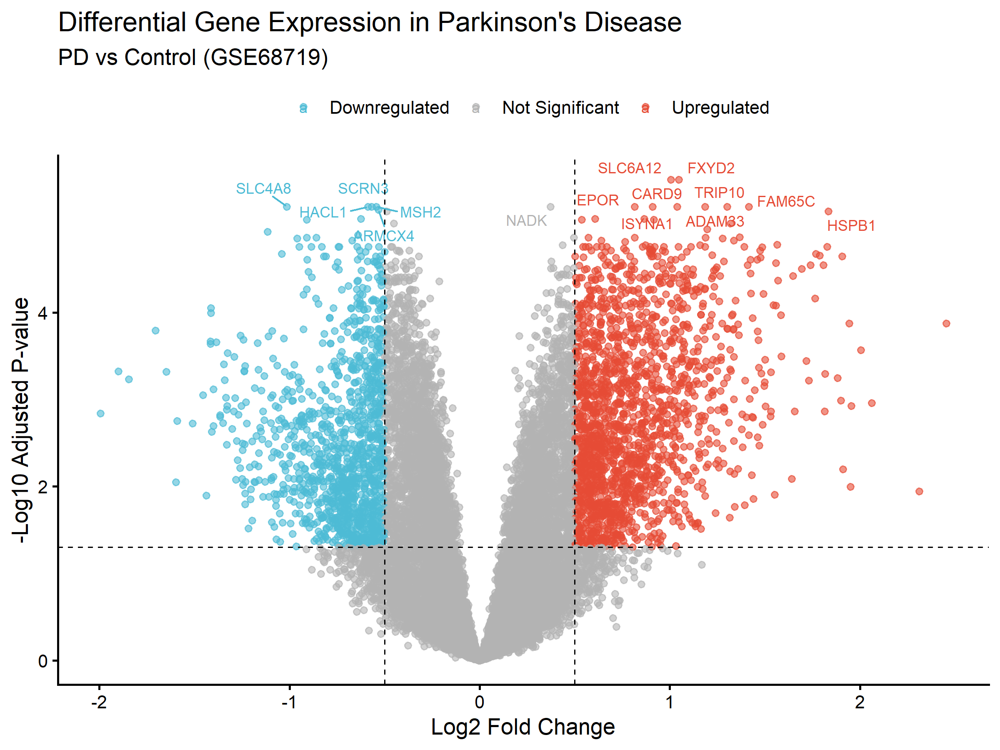
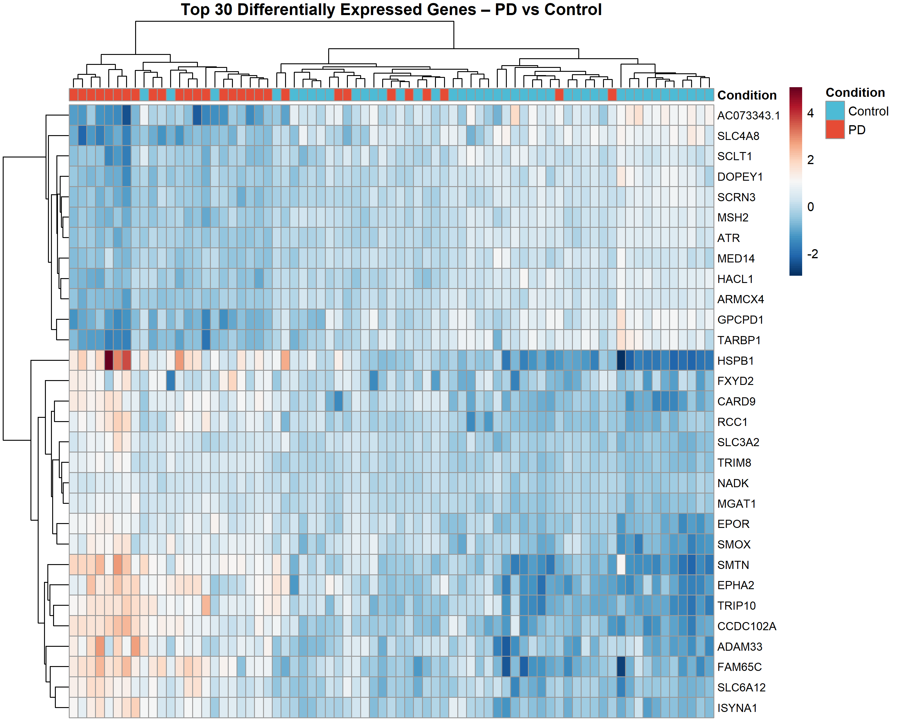
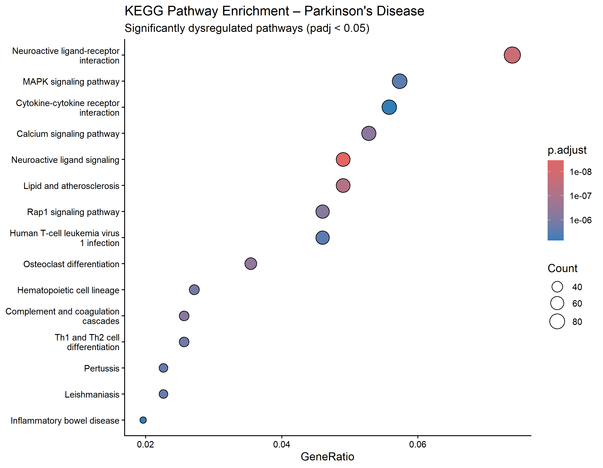
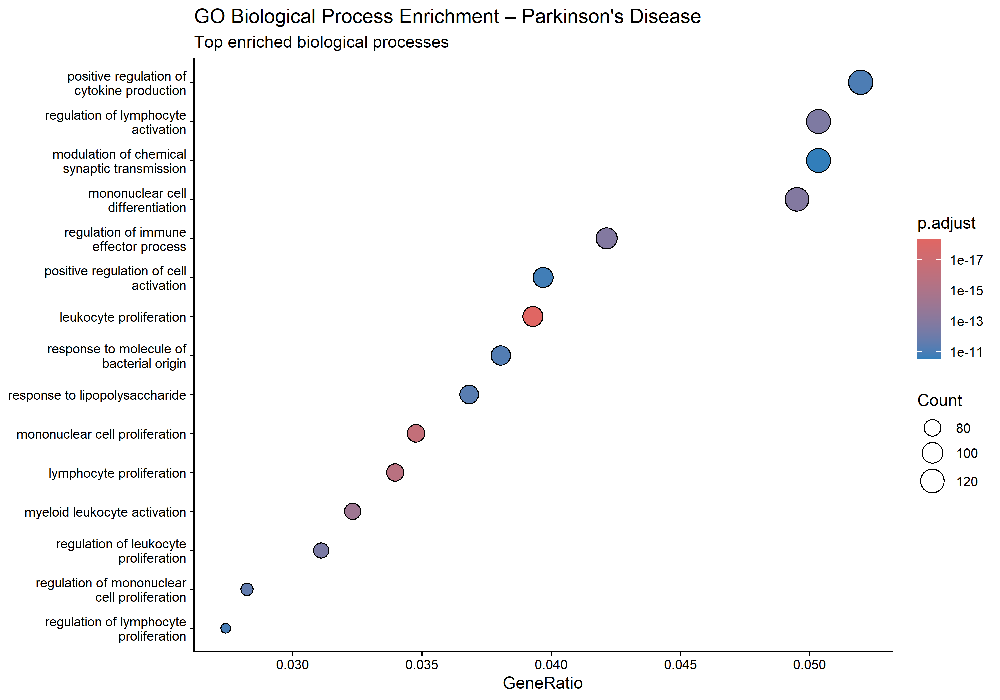
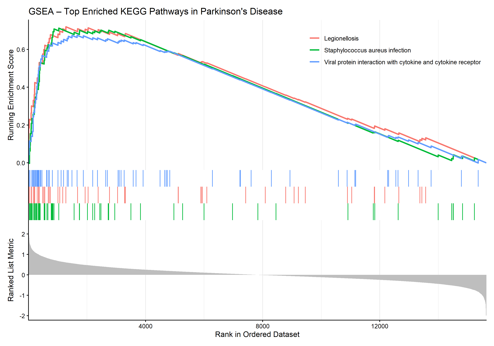
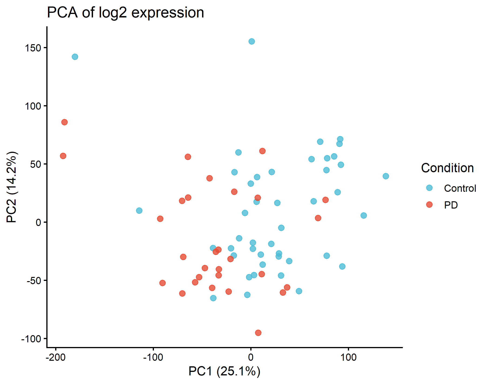

# Bioinformatics Portfolio

Transcriptomics analysis and tooling by **Hammad Ali Hassan** · ORCID [0000-0002-9174-7673](https://orcid.org/0000-0002-9174-7673)

Both projects use **public data**. My client and collaborator analyses are confidential and are not shown here.

| Project | What it is |
|---|---|
| [1. Parkinson's disease transcriptomics](#1-parkinsons-disease-transcriptomics-in-prefrontal-cortex) | RNA-seq differential expression and pathway analysis in R |
| [2. DE Advisor](#2-de-advisor-a-local-app-that-checks-your-data-before-testing) | A local Shiny app that checks the data type, then runs the right test |

---

## 1. Parkinson's disease transcriptomics in prefrontal cortex

**Dataset:** [GSE68719](https://www.ncbi.nlm.nih.gov/geo/query/acc.cgi?acc=GSE68719) (NCBI GEO), post-mortem BA9 prefrontal cortex, Parkinson's disease (n = 29) vs control (n = 44).
**Script:** [`PD_analysis_PUBLIC.R`](PD_analysis_PUBLIC.R) · **Run summary:** [`results_summary.txt`](results_summary.txt) · **Full results table:** [`limma_PD_results.csv`](limma_PD_results.csv)

### Methods
- Input: DESeq2-normalized counts for protein-coding genes (GEO supplementary file). Because the values are already normalized, not raw counts, I used **limma** on log2(count + 1) with trend and robust empirical Bayes moderation. DESeq2 would not be appropriate for this input.
- Genes expressed (log2 value > 1) in fewer than 10 samples were filtered out.
- Quality control: PCA.
- Significance: adjusted p < 0.05 and |log2 fold change| > 0.5.
- Enrichment: KEGG and GO (biological process) over-representation, plus KEGG GSEA on all genes ranked by log2 fold change (clusterProfiler).
- Validation: log2 fold changes compared with the original authors' published DESeq2 results.

### Results
- **17,518** genes were tested after filtering; **2,987** were significant (**1,794** up and **1,193** down in PD).
- Fold changes correlate with the original authors' published results (**r = 0.83**). Highly ranked genes such as HSPB1 and FXYD2 also appear among the authors' top hits.
- Enrichment shows **immune and inflammatory signalling together with neuronal signalling**: neuroactive ligand-receptor interaction, calcium and MAPK signalling, and cytokine-cytokine receptor interaction (KEGG); leukocyte and lymphocyte proliferation and activation (GO); immune and infection gene sets (GSEA). This is consistent with neuroinflammation reported in Parkinson's disease.
- Metabolism-related terms appeared among the enriched terms (4 KEGG and 6 GSEA terms by keyword match) but did not rank among the top terms. They were not examined further.

| Volcano plot | Top 30 genes |
|---|---|
|  |  |

| KEGG enrichment | GO enrichment |
|---|---|
|  |  |

| GSEA | PCA |
|---|---|
|  |  |

### Limitations
- The model does not adjust for age, post-mortem interval, or RNA quality. The original authors did.
- Bulk tissue: cell-type composition (for example, more microglia) can contribute to immune signals.
- This is a workflow demonstration, so the findings are exploratory and not a claim about disease mechanism or treatment.

### How to run
1. Install R (4.4 or newer) and the packages listed at the top of `PD_analysis_PUBLIC.R`.
2. Set the working directory to the folder that holds the script, then run `source("PD_analysis_PUBLIC.R")`.
3. The script downloads the data into `data/` and writes outputs to `results/`. KEGG steps need an internet connection.

---

## 2. DE Advisor: a local app that checks your data before testing

**Download:** [`DE_Advisor_1.2.zip`](https://github.com/Hammadali87/bioinformatics-portfolio/raw/main/DE_Advisor_1.2.zip)

A common mistake in RNA-seq analysis is running DESeq2 on values that are not raw counts. DE Advisor is a local R Shiny app that **inspects the uploaded expression table first** (raw counts, normalized values, or log-scale), recommends DESeq2 or limma accordingly, and blocks DESeq2 on data that are not raw integer counts.

**What it does**
- Detects the data type and explains the recommendation.
- Defines groups from sample names or from a sample sheet, with optional covariates (version 1.2).
- Runs DESeq2 or limma, and shows a results table, volcano plot, PCA, and heatmap.
- Optional GO and KEGG enrichment for human gene symbols.
- Writes a methods paragraph that records the test, filters, and thresholds.

**Privacy:** it runs on your own computer, so your data are not uploaded anywhere.

**Validation:** run on GSE68719 (Project 1), it flagged the data as normalized, chose limma, and reproduced the group sizes (29 PD vs 44 control), the significant-gene counts (1,794 up, 1,193 down), and the top genes. The `treat` option, covariate models, and DESeq2 mode have not yet been validated on real data.

### Setup and use (Windows)
1. Install R (version 4.4 or newer) from https://cran.r-project.org/bin/windows/base/ in the default location.
2. Download the zip and extract it to a simple folder path (no apostrophes or special characters). Do not run the files from inside the zip.
3. First time only: double-click `1_Install_Once.bat` and wait until it finishes (10-30 minutes, needs internet).
4. Every time: double-click `2_Start_DE_Advisor.bat`. Keep the black window open while you use the app; the app opens in your browser. Close the black window to stop it.
5. Optional, for the GO/KEGG enrichment tab: run `install_optional_packages.R` once (open it in RStudio and click Source).

If R is installed in another location, or you are on Mac or Linux, open `app.R` in RStudio and click Run App. Tested on Windows with R 4.6.2.

### Limitations
- Two-group comparison only. Results are exploratory; check the model design before drawing conclusions.
- Enrichment is limited to human gene symbols.

---

## Files
| File | Content |
|---|---|
| `PD_analysis_PUBLIC.R` | Parkinson's analysis script |
| `*.png`, `limma_PD_results.csv`, `results_summary.txt`, `session_info.txt` | Figures and outputs from the analysis |
| `DE_Advisor_1.2.zip` | The local app and its launchers |
